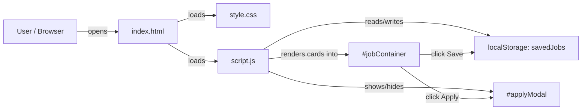
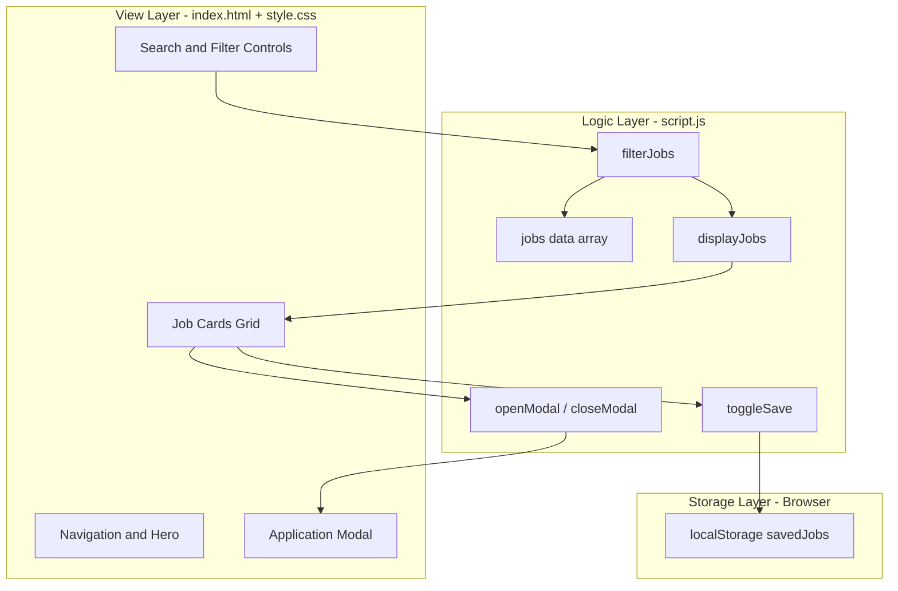
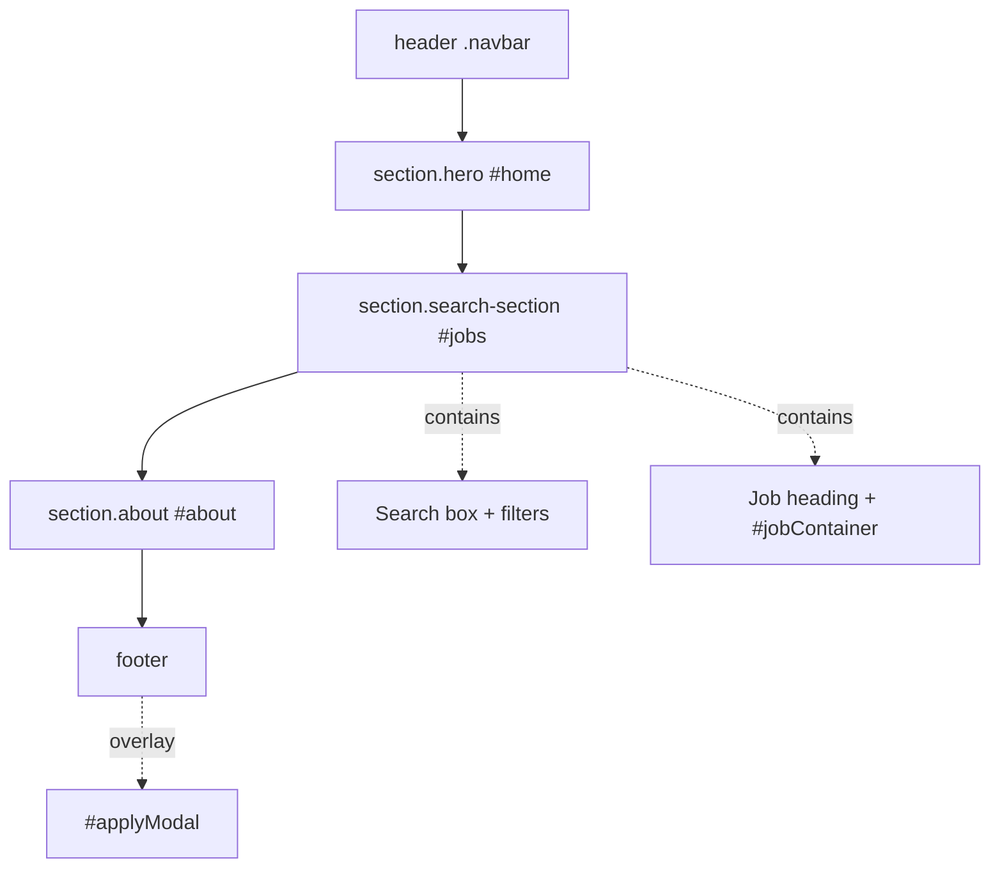
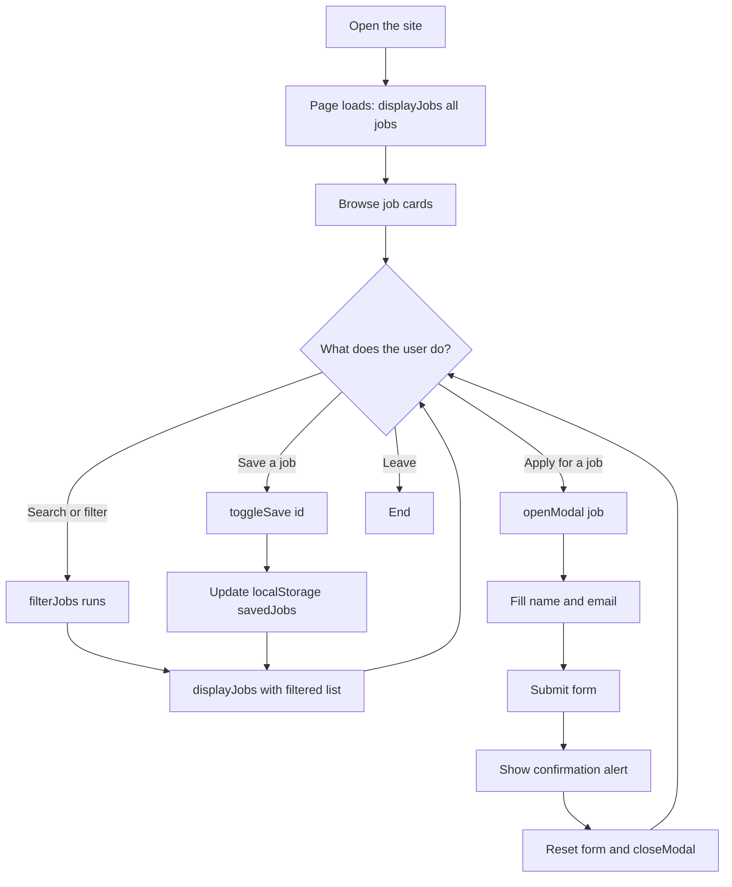
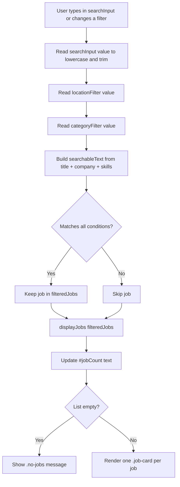
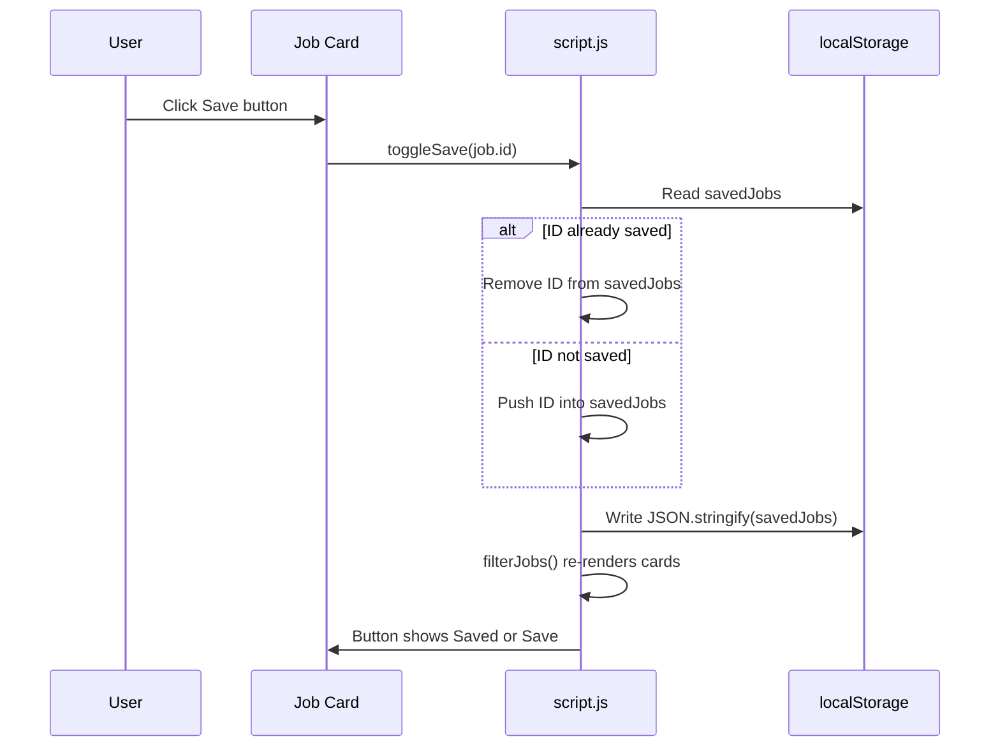
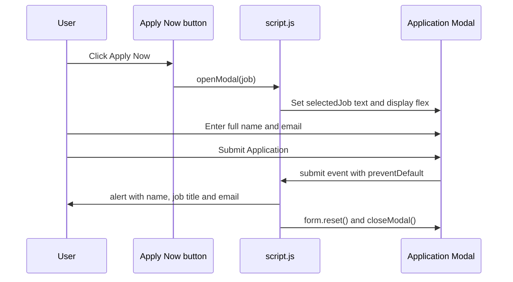
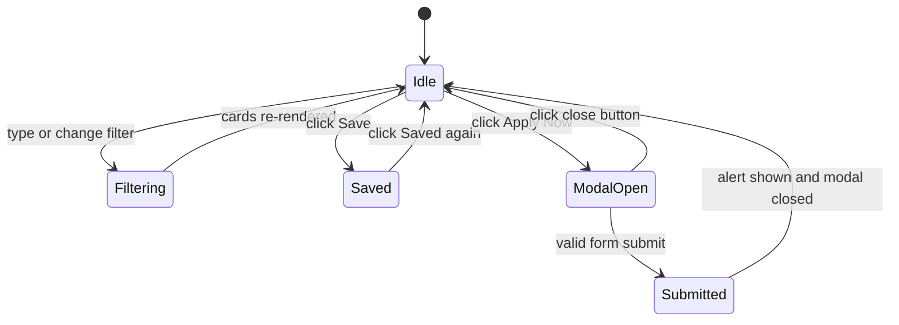

# Job Finder Portal

> **Repository:** https://github.com/ritthik7877/Job-Finder-Portal  
> **Documentation version:** 2.0  
> **Last updated:** 22/11/2026 (22 November 2026)  
> **Status:** Static frontend demo — fully functional in the browser, no backend required.

## Live deployment

[Open the deployed Job Finder Portal](https://job-find-portal-lyyyypt20-ritthik-s-projects.vercel.app)

## Table of Contents

| # | Section | Purpose |
|---|---------|---------|
| 1 | [About](#about) | What the project is |
| 2 | [Features](#features) | What the application can do |
| 3 | [Technologies Used](#technologies-used) | Tools and libraries |
| 4 | [How to Run](#how-to-run) | Quick start |
| 5 | [Future Improvements](#future-improvements) | Planned roadmap |
| 6 | [Author](#author) | Project owner |
| 7 | [Project At a Glance](#project-at-a-glance) | High-level facts |
| 8 | [Repository Structure](#repository-structure) | File-by-file breakdown |
| 9 | [Architecture Diagrams](#architecture-diagrams) | System and page diagrams |
| 10 | [Workflow Diagrams](#workflow-diagrams) | Search, save and apply flows |
| 11 | [Setup and Installation](#setup-and-installation) | Prerequisites, downloads and commands |
| 12 | [Download and Setup Checklist](#download-and-setup-checklist) | Step-by-step verification |
| 13 | [Usage Guide](#usage-guide) | How to use every control |
| 14 | [Data and State Reference](#data-and-state-reference) | Jobs, filters and storage |
| 15 | [Responsive Design](#responsive-design) | Breakpoints and layout |
| 16 | [Styling Reference](#styling-reference) | Colours and typography |
| 17 | [Testing and Verification](#testing-and-verification) | Manual test cases |
| 18 | [Troubleshooting](#troubleshooting) | Common problems and fixes |
| 19 | [Security and Privacy Notes](#security-and-privacy-notes) | Demo limitations |
| 20 | [Contributing](#contributing) | How to contribute |
| 21 | [Changelog](#changelog) | Change history including 22/11/2026 |

## About

Job Finder Portal is a responsive frontend web application designed to help users explore and search for job opportunities based on their skills, interests and preferred locations.

The application provides a simple interface where users can browse job listings, filter opportunities and save their favourite jobs.

## Features

- Search jobs by title, company and skills.
- Filter jobs by location and category.
- View job details and salary information.
- Save favourite jobs.
- Apply through an application form.
- Responsive design for desktop and mobile.

### Feature detail matrix

| Feature | User action | Implementation | Result |
|---------|-------------|----------------|--------|
| Keyword search | Type in the search box or press **Search** | `filterJobs()` matches title, company and skills | Matching cards are rendered instantly |
| Location filter | Choose a location dropdown value | Exact match on `job.location` | Only jobs from that location remain |
| Category filter | Choose a category dropdown value | Exact match on `job.category` | Only jobs in that category remain |
| Job details | Read a job card | `displayJobs()` builds card markup | Type, title, company, location, salary and skills are shown |
| Save job | Click **♡ Save** | `toggleSave(id)` + `localStorage` | Button changes to **♥ Saved** and persists after reload |
| Remove saved job | Click **♥ Saved** | `toggleSave(id)` removes the id | Button returns to **♡ Save** |
| Apply | Click **Apply Now** | `openModal(job)` | Application modal opens with the selected position |
| Submit application | Fill name and email, click **Submit Application** | Form `submit` handler with `event.preventDefault()` | Demo confirmation alert is shown, form resets, modal closes |
| Responsive UI | Resize the browser | CSS media queries at 900px and 600px | Grid changes from 3 to 2 to 1 column |

## Technologies Used

- HTML5
- CSS3
- JavaScript
- Local Storage

### Technology stack table

| Layer | Technology | Version / standard | Role in this project | External dependency |
|-------|-----------|--------------------|----------------------|---------------------|
| Markup | HTML5 | Living standard | Page structure, sections, forms and modal | None |
| Styling | CSS3 | Living standard | Layout, colours, hover effects and media queries | None |
| Logic | JavaScript (ES6+) | Modern browser JS | Job data, filtering, rendering, storage and modal handling | None |
| Persistence | Web Storage API | `localStorage` | Stores saved job IDs under `savedJobs` | Built into the browser |
| Editor (recommended) | Visual Studio Code | Latest stable | Source editing and Live Server extension | Optional |
| Local server (recommended) | VS Code Live Server / Python `http.server` | Latest / Python 3 | Serves the site over `http://localhost` | Optional |
| Version control | Git + GitHub | Latest | Source history and remote hosting | Required for cloning |

> **Note:** There is no `package.json`, no build step and no framework. The application runs directly in a browser.

## How to Run

1. Clone the repository.
2. Open the project folder in VS Code.
3. Open index.html using Live Server.

See [Setup and Installation](#setup-and-installation) for the full command-by-command version, including alternatives to Live Server.

## Future Improvements

- User registration and login.
- Backend integration.
- Database connectivity.
- Real job listings through APIs.
- Resume upload functionality.

### Prioritised roadmap

| Priority | Improvement | Benefit | Suggested approach |
|----------|-------------|---------|--------------------|
| High | Real job listings through APIs | Live data instead of the 6 hard-coded jobs | Fetch from a job API and render with `displayJobs()` |
| High | User registration and login | Personalised saved jobs across devices | Auth provider plus user records |
| Medium | Backend integration | Store applications instead of showing an alert | REST API with an application endpoint |
| Medium | Database connectivity | Persistent jobs, users and applications | PostgreSQL or MongoDB |
| Medium | Resume upload functionality | Real applications | File input plus object storage |
| Low | Pagination and sorting | Better UX for large result sets | Sort controls and page state |
| Low | Unit and end-to-end tests | Safer refactoring | Jest/Vitest plus Playwright |

## Author

Ritthik RB
MCA Student | Aspiring Frontend Developer

---

## Detailed Documentation

*The remainder of this README expands the original documentation with structured diagrams, workflows, commands and reference tables. Added on 22/11/2026.*

## Project At a Glance

| Attribute | Value |
|-----------|-------|
| Project name | Job Finder Portal (branded as **JobFinder**) |
| Repository | `ritthik7877/Job-Finder-Portal` |
| Branch | `main` |
| Application type | Responsive single-page frontend demo |
| Domain | Job search and discovery |
| Architecture | Static client-side app (HTML + CSS + JavaScript) |
| Data source | Hard-coded `jobs` array in `script.js` (6 records) |
| Persistence | Browser `localStorage` key `savedJobs` |
| Backend / API / database | None |
| Build tooling | None |
| Runtime | Any modern web browser |
| Default local URL | `http://localhost:5500` with Live Server |
| Copyright line | © 2026 JobFinder. All Rights Reserved. |

## Repository Structure

```text
Job-Finder-Portal/
├── README.md       # Project documentation (this file)
├── index.html      # Page markup: navbar, hero, search, jobs, about, footer, modal
├── style.css       # Styling: layout, cards, modal and responsive breakpoints
└── script.js       # Job data and all browser-side behaviour
```

| File | Lines (approx.) | Responsibility | Key contents |
|------|-----------------|----------------|--------------|
| `README.md` | 43+ | Documentation | Overview, features, setup, workflows and references |
| `index.html` | 106 | Structure and controls | `#searchInput`, `#locationFilter`, `#categoryFilter`, `#jobContainer`, `#applyModal`, `#applicationForm` |
| `style.css` | 300 | Presentation | `.navbar`, `.hero`, `.search-box`, `.job-container`, `.job-card`, `.modal`, media queries |
| `script.js` | 190 | Behaviour | `jobs` array, `displayJobs()`, `filterJobs()`, `toggleSave()`, `openModal()`, `closeModal()`, event listeners |

## Architecture Diagrams

### High-level architecture



### Application layers



### Page section map



## Workflow Diagrams

### End-to-end user workflow



### Search and filter workflow



### Save / unsave workflow



### Application modal workflow



### State lifecycle



## Setup and Installation

### Prerequisites and downloads

| # | Requirement | Why it is needed | Download / install | Verify with | Mandatory |
|---|-------------|------------------|--------------------|-------------|-----------|
| 1 | Modern browser (Chrome, Edge, Firefox or Safari) | Runs the HTML, CSS and JavaScript | https://www.google.com/chrome/ or https://www.mozilla.org/firefox/new/ | Open `chrome://version` or `about:` page | Yes |
| 2 | Git | Clone the repository and push changes | https://git-scm.com/downloads | `git --version` | Yes (for cloning) |
| 3 | Visual Studio Code | Convenient editing and Live Server | https://code.visualstudio.com/download | `code --version` | Recommended |
| 4 | Live Server extension | Auto-refresh local server | In VS Code Extensions, search **Live Server** (ritwickdey.LiveServer) | **Go Live** button in status bar | Recommended |
| 5 | Python 3 | Alternative local server, no extension needed | https://www.python.org/downloads/ | `python --version` | Optional |
| 6 | Node.js + npm | Alternative `npx serve` local server | https://nodejs.org/ | `node --version` | Optional |
| 7 | GitHub account | Access the remote repository | https://github.com/signup | `gh auth status` | Yes (for cloning/pushing) |
| 8 | GitHub CLI (`gh`) | Authenticated clone and repo commands | https://cli.github.com/ | `gh auth status` | Optional |

### Step-by-step setup

1. **Download and install Git** from https://git-scm.com/downloads, then confirm `git --version`.
2. **Download and install VS Code** from https://code.visualstudio.com/download.
3. **Install the Live Server extension** inside VS Code (Extensions → search `Live Server` → Install).
4. **Clone the repository** with the command below.
5. **Open the folder in VS Code** and wait for dependencies (there are none to install).
6. **Start Live Server** by right-clicking `index.html` → **Open with Live Server**, or click **Go Live**.
7. **Open the local URL** (usually `http://localhost:5500`) and verify the job cards appear.

### Command reference

| Step | Command (Windows PowerShell) | Purpose | Expected output |
|------|------------------------------|---------|-----------------|
| 1 | `git --version` | Confirm Git installation | `git version 2.x.x` |
| 2 | `git clone https://github.com/ritthik7877/Job-Finder-Portal.git` | Download the repository | `Cloning into 'Job-Finder-Portal'...` |
| 3 | `cd Job-Finder-Portal` | Enter the project folder | Prompt path changes |
| 4 | `code .` | Open folder in VS Code | VS Code window opens |
| 5 | Right-click `index.html` → **Open with Live Server** | Serve the app | Browser opens at `http://localhost:5500` |
| 6 | `python -m http.server 5500` | Alternative server (Python) | `Serving HTTP on :: port 5500` |
| 7 | `npx serve .` | Alternative server (Node.js) | `Serving...` with a local URL |
| 8 | `git status` | Check working tree | Shows modified/untracked files |
| 9 | `git pull origin main` | Get latest changes | `Already up to date.` or updated files |
| 10 | `git add README.md` | Stage documentation changes | No output |
| 11 | `git commit -m "Update README"` | Record changes | Commit summary |
| 12 | `git push origin main` | Upload changes | Remote updated |

### Ways to run the application

| Method | Command / action | URL | Auto-reload | Notes |
|--------|------------------|-----|-------------|-------|
| Live Server (recommended) | VS Code → **Go Live** | `http://localhost:5500` | Yes | Best developer experience |
| Python HTTP server | `python -m http.server 5500` | `http://localhost:5500` | No | Works on any OS with Python 3 |
| Node `serve` | `npx serve .` | Shown in terminal | No | Requires Node.js/npm |
| Direct file open | Double-click `index.html` | `file:///.../index.html` | No | Works, but use a local server for realistic `localStorage` behaviour |

### Port reference

| Port | Used by | Notes |
|------|---------|-------|
| 5500 | VS Code Live Server (default) | Change via `liveServer.settings.port` if occupied |
| 8000 | Python `http.server` (common alternative) | `python -m http.server 8000` |
| 3000 | `npx serve` (common alternative) | Shown by `serve` on startup |

## Download and Setup Checklist

| # | Step | Action | Command / location | Expected result | Done |
|---|------|--------|--------------------|-----------------|------|
| 1 | Install browser | Download a modern browser | Official browser site | Browser launches | ☐ |
| 2 | Install Git | Run installer with defaults | Official Git site | `git --version` works | ☐ |
| 3 | Install VS Code | Run installer with defaults | Official VS Code site | `code --version` works | ☐ |
| 4 | Add Live Server | Extensions → search and install | Inside VS Code | **Go Live** appears | ☐ |
| 5 | Clone repo | Run clone command | PowerShell | Folder `Job-Finder-Portal` exists | ☐ |
| 6 | Open project | `cd Job-Finder-Portal`, then `code .` | PowerShell | Editor opens with 4 files | ☐ |
| 7 | Start server | Right-click `index.html` → Open with Live Server | VS Code | Browser opens on localhost | ☐ |
| 8 | Verify UI | Look for 6 job cards and "6 jobs found" | Browser | Cards and count visible | ☐ |
| 9 | Test search | Type `React` in search box | Browser | 2 matching cards appear | ☐ |
| 10 | Test save | Click **Save** then refresh | Browser | **♥ Saved** persists | ☐ |
| 11 | Test apply | Click **Apply Now** and submit | Browser | Confirmation alert appears | ☐ |

## Usage Guide

### UI sections

| Section | Element / selector | Purpose | Visible controls |
|---------|--------------------|---------|------------------|
| Navigation | `header .navbar` | Brand and page anchors | Home, Find Jobs, About, Explore Jobs |
| Hero | `section.hero#home` | Main headline and call to action | Explore Opportunities |
| Search | `section.search-section#jobs` | Find and filter jobs | Search input, 2 dropdowns, Search button |
| Results | `.job-heading` + `#jobContainer` | Result count and job cards | Count text, cards, Save and Apply buttons |
| About | `section.about#about` | Short product description | Text only |
| Footer | `footer` | Branding and copyright | Text only |
| Modal | `#applyModal` | Demo application form | Close, name, email, submit |

### Search and filter controls

| Control | Element ID | Type | Behaviour | Live trigger |
|---------|-----------|------|-----------|--------------|
| Keyword input | `searchInput` | Text | Case-insensitive match against title, company and skills | `input` event + Search button |
| Location dropdown | `locationFilter` | Select | Exact match; options: All Locations, Coimbatore, Chennai, Bangalore, Remote | `change` event + Search button |
| Category dropdown | `categoryFilter` | Select | Exact match; options: All Categories, Development, Design, Data Analytics, Marketing | `change` event + Search button |
| Search button | n/a (inline `onclick`) | Button | Calls `filterJobs()` | `click` |

### Job dataset (hard-coded in `script.js`)

| ID | Title | Company | Location | Category | Type | Salary | Skills |
|----|-------|---------|----------|----------|------|--------|--------|
| 1 | Frontend Developer | Tech Solutions | Coimbatore | Development | Full Time | ₹3 - 5 LPA | HTML CSS JavaScript React |
| 2 | Python Developer | Innovate Technologies | Chennai | Development | Full Time | ₹3 - 4 LPA | Python Django SQL |
| 3 | UI/UX Designer | Creative Studio | Bangalore | Design | Internship | ₹15,000/month | Figma UI UX Design |
| 4 | Data Analyst | DataTech | Coimbatore | Data | Full Time | ₹3 - 4 LPA | Python SQL Excel Power BI |
| 5 | Digital Marketing Executive | Growth Media | Remote | Marketing | Full Time | ₹2 - 3 LPA | SEO Social Media Marketing |
| 6 | React Developer | WebCraft | Bangalore | Development | Internship | ₹12,000/month | React JavaScript CSS |

### Favourites and application form

| Item | Detail |
|------|--------|
| Storage key | `savedJobs` |
| Stored value | JSON array of job IDs, for example `[1, 4]` |
| Save action | Adds the ID if missing, removes it if present |
| Re-render | `filterJobs()` is called after every save change |
| Persistence | Survives browser refresh; limited to the current browser/profile/origin |
| Modal fields | Full name (`applicantName`, required), email (`applicantEmail`, required) |
| Submit behaviour | Cancels native submit, shows an alert, resets the form and closes the modal |
| Data sent to server | None — demo only, explicitly noted in the modal |

## Data and State Reference

### Browser storage

| Key | Type | Written by | Read by | Purpose |
|-----|------|-----------|---------|---------|
| `savedJobs` | JSON array of numbers | `toggleSave()` | Initial load of `script.js` | Remember saved job IDs |

### In-memory variables (`script.js`)

| Variable | Initial value | Purpose |
|----------|---------------|---------|
| `jobs` | Array of 6 job objects | Source data for rendering and filtering |
| `jobContainer` | `#jobContainer` element | Mount point for job cards |
| `jobCount` | `#jobCount` element | Displays `<n> jobs found` |
| `savedJobs` | Parsed `localStorage.savedJobs` or `[]` | Current saved IDs |
| `selectedJob` | `null` | Job currently being applied for |

### DOM element IDs

| ID | Element | Used by |
|----|---------|---------|
| `home`, `jobs`, `about` | Sections | Navigation anchors |
| `searchInput` | `input` | `filterJobs()`, live search listener |
| `locationFilter` | `select` | `filterJobs()`, change listener |
| `categoryFilter` | `select` | `filterJobs()`, change listener |
| `jobContainer` | `div` | `displayJobs()` |
| `jobCount` | `span` | `displayJobs()` |
| `applyModal` | `div` | `openModal()`, `closeModal()` |
| `selectedJob` | `p` | `openModal()` |
| `applicationForm` | `form` | Submit listener |
| `applicantName`, `applicantEmail` | `input` | Form handler and alert |

### Core functions

| Function | Trigger | Description |
|----------|---------|-------------|
| `displayJobs(jobList)` | Initial load and after filtering | Clears container, updates count, renders cards or empty message, binds button handlers |
| `filterJobs()` | Input/change events and Search button | Reads controls, applies search/location/category predicates, calls `displayJobs()` |
| `toggleSave(id)` | Save button click | Adds/removes ID, updates `localStorage`, re-renders |
| `openModal(job)` | Apply button click | Stores `selectedJob`, fills position text, shows modal with `display = flex` |
| `closeModal()` | Close button and after submit | Hides modal with `display = none` |

## Responsive Design

| Breakpoint | Grid columns | Search box layout | Other changes |
|------------|--------------|-------------------|---------------|
| `> 900px` (desktop) | 3 | Single row, flex items side by side | Default layout; hero heading 46px |
| `≤ 900px` (tablet) | 2 | Items wrap | Hero and search padding adjusted |
| `≤ 600px` (mobile) | 1 | Column, full-width inputs | Navbar wraps, nav links centred, hero heading 32px, job heading stacks |

## Styling Reference

### Colour palette

| Token | Hex | Used for |
|-------|-----|----------|
| Primary blue | `#2563eb` | Buttons, links, highlights, hero span |
| Dark blue | `#1d4ed8` | Logo and job-type text |
| Page background | `#f7f9fc` | Body background |
| Hero gradient start | `#dbeafe` | Hero and job-type background |
| Hero gradient end | `#eff6ff` | Hero gradient and about background |
| Dark footer | `#0f172a` | Footer background |
| Body text | `#1e293b` | Default text colour |
| Muted text | `#64748b` | Secondary text |
| Border | `#e2e8f0` / `#cbd5e1` | Card borders and input borders |

### Layout notes

| Aspect | Value |
|--------|-------|
| Font family | Arial, sans-serif |
| Box sizing | `border-box` on all elements |
| Smooth scrolling | Enabled globally with `scroll-behavior: smooth` |
| Card grid gap | 22px |
| Card hover | Moves up 5px and adds a shadow |
| Search box | White panel with rounded 10px corners and soft shadow |
| Modal overlay | Fixed full screen, semi-transparent black, `z-index: 10` |

## Testing and Verification

Perform these manual checks in the browser after each setup.

| # | Test case | Steps | Expected result |
|---|-----------|-------|-----------------|
| 1 | Initial render | Open the site | 6 cards and "6 jobs found" |
| 2 | Keyword search | Type `python` | Jobs 2 and 4 remain |
| 3 | Company search | Type `WebCraft` | Job 6 remains |
| 4 | Skills search | Type `Figma` | Job 3 remains |
| 5 | Location filter | Select `Coimbatore` | Jobs 1 and 4 remain |
| 6 | Category filter | Select `Development` | Jobs 1, 2 and 6 remain |
| 7 | Combined filter | Search `sql`, location `Coimbatore` | Job 4 only |
| 8 | Empty state | Type `zzzz` | "No jobs found. Try another search." |
| 9 | Clear filters | Clear input and set both filters to All | 6 jobs again |
| 10 | Save persistence | Save job 1, refresh, check button | Shows "♥ Saved" |
| 11 | Unsave | Click "♥ Saved" for job 1 | Shows "♡ Save" after refresh |
| 12 | Apply modal | Click Apply Now on job 3 | Modal shows "Position: UI/UX Designer at Creative Studio" |
| 13 | Form validation | Submit with empty fields | Browser blocks submission |
| 14 | Submit application | Enter name and email, submit | Alert with details, form cleared, modal closed |
| 15 | Close modal | Open modal, click × | Modal disappears |
| 16 | Responsive | Resize to 800px then 500px | 2 columns then 1 column |

## Troubleshooting

| Problem | Likely cause | Fix |
|---------|--------------|-----|
| Page shows unstyled content | `style.css` path wrong or missing | Confirm `style.css` sits beside `index.html` |
| No job cards appear | `script.js` not loaded or JS error | Check DevTools Console; confirm script tag path |
| Live Server not starting | Port 5500 in use | Change `liveServer.settings.port` or use `python -m http.server 5501` |
| Saved jobs reset | Different browser/profile/origin, or private mode | Use the same browser and URL; avoid incognito |
| Filters do nothing | Browser cached old files | Hard refresh (`Ctrl+F5`) or restart Live Server |
| Modal stays hidden | CSS `.modal { display: none }` not overridden | Confirm `openModal()` sets `style.display = "flex"` |
| `git clone` asks for credentials | Git not authenticated | Use HTTPS with a PAT or `gh auth login` |
| Push rejected | Remote has newer commits | Run `git pull --rebase origin main`, then push again |

## Security and Privacy Notes

| Topic | Current behaviour | Implication |
|-------|-------------------|-------------|
| Application data | Only used in a browser `alert()` | No data is stored or transmitted |
| Saved jobs | Stored locally in `localStorage` | Visible only in the current browser/profile |
| Authentication | None | No accounts or personal data on the server |
| External APIs | None | No third-party calls from the frontend |
| Input validation | HTML `required` plus built-in email type | Client-side only; add server validation in a real app |
| Secrets | None in the repository | Safe to keep public |

## Contributing

| Step | Action | Command / detail |
|------|--------|------------------|
| 1 | Fork or clone | `git clone https://github.com/ritthik7877/Job-Finder-Portal.git` |
| 2 | Create a branch | `git checkout -b feature/my-change` |
| 3 | Edit files | Keep the existing vanilla HTML/CSS/JS style |
| 4 | Verify manually | Run the [Testing and Verification](#testing-and-verification) table |
| 5 | Stage changes | `git add .` |
| 6 | Commit | `git commit -m "Describe the change"` |
| 7 | Push | `git push origin feature/my-change` |
| 8 | Open a pull request | Compare against `main` |

## Changelog

| Date | Version | Change | Author |
|------|---------|--------|--------|
| 21/11/2026 | 1.0 | Added initial README with About, Features, Technologies Used, How to Run, Future Improvements and Author (`ba3325a`) | Ritthik RB |
| 22/11/2026 | 2.0 | Expanded the existing README into a structured guide with diagrams, workflows, setup commands, download tables, usage/data references, testing, troubleshooting and changelog | Ritthik RB |

> The 21/11/2026 README commit is retained; the 22/11/2026 update appends the detailed documentation rather than replacing the original project description.

---

**Maintained by:** Ritthik RB — MCA Student | Aspiring Frontend Developer  
**Last updated:** 22/11/2026
